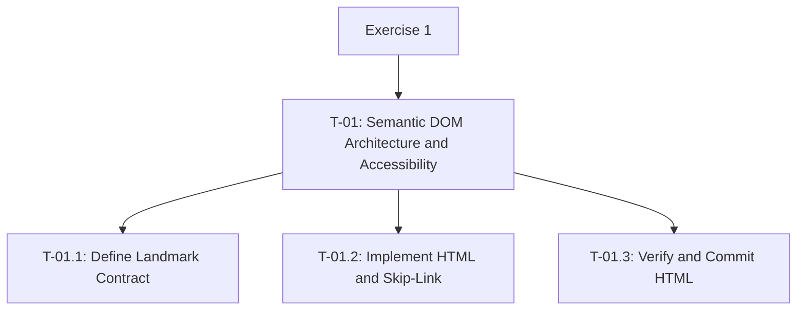

# TASK_DECOMPOSITION

## 1. Goal and Requirements

Exercise 1: Semantic DOM Architecture & A11y Contract.

- Use zero div elements.
- Include exactly one h1 and sequential heading levels.
- Implement semantic landmarks and an accessible skip-link.
- Verify landmarks in Chrome DevTools Accessibility.
- Commit HTML separately from CSS and JavaScript.

## 2. WBS

## 3. Task Table

| WBS ID | Task | Deliverable | Completion Criteria | Dependency | Status |
|---|---|---|---|---|---|
| T-01 | Semantic DOM Architecture and Accessibility | Verified HTML | All subtasks completed | None | Not started |
| T-01.1 | Define Landmark Contract | Written structure contract | Landmarks, headings, and link targets defined | None | Not started |
| T-01.2 | Implement HTML and Skip-Link | index.html | HTML matches the contract | T-01.1 | Not started |
| T-01.3 | Verify and Commit HTML | Verification record and commit | Keyboard and landmark checks pass; HTML committed separately | T-01.2 | Not started |

## 4. Landmark Contract

- Place the skip-link before header: href="#main".
- Header contains exactly one h1.
- Navigation contains links to #about and #projects.
- Main uses id="main".
- Main contains sections with id="about" and id="projects".
- Each section has an h2.
- Use zero div elements.
- Do not add CSS or JavaScript during this task.
- Landmark hierarchy: page-level header, navigation, and main. The about and projects sections are children of main. The skip-link appears before the header.

## 5. Definition of Done

- [ ] Zero div elements.
- [ ] Exactly one h1; no skipped heading levels.
- [ ] Semantic landmark hierarchy implemented.
- [ ] Navigation targets match section ids.
- [ ] Skip-link works using the keyboard.
- [ ] Landmark tree verified in Chrome DevTools → Accessibility,with the result recorded.
- [ ] HTML committed separately from CSS and JavaScript using the exact message: feat(html): semantic landmark tree.

## 6. AI Assistance Log

- Tool: ChatGPT.
- Assisted task: T-01 planning.
- Purpose: Review and refine the task decomposition.
- Verification method: Compare the plan with the assignment;
  inspect HTML and test keyboard navigation and landmarks.