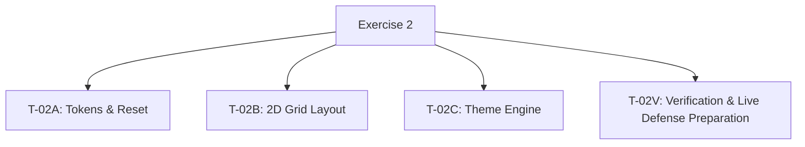

# TASK_DECOMPOSITION — Exercise 2

## 1. Objective, Requirements and Starting Point

### Objective

Extend the semantic portfolio HTML from Exercise 1 with reusable CSS
design tokens, a basic reset, a mobile-first two-dimensional Grid layout,
and a persistent light/dark theme engine.

### Starting Point

- Exercise 1 is complete.
- Its semantic `index.html` is reused in the separate `Exercise_2` folder.
- The completed Exercise 1 HTML is an external prerequisite.
- Preserve the semantic structure, heading hierarchy, landmarks,
  navigation targets and skip-link target.
- Exercise 2 will use a separate Git repository.
- T-02A is in progress; verification and commit results are pending.
- T-02B, T-02C and T-02V are not started.

### Assignment Requirements

- Use vanilla HTML, CSS and JavaScript.
- Do not use frameworks, CSS libraries or CDNs.
- Define paired light/dark CSS custom properties for colors.
- Use `var(...)` for colors in selector rules.
- Keep hardcoded hex colors within token declarations.
- Implement a mobile-first two-dimensional CSS Grid layout.
- Support a 375px viewport without horizontal scrolling.
- Meet the required text contrast ratio of at least 4.5:1 in both themes.
- Support keyboard navigation using Tab and Enter.
- Persist the selected theme using the localStorage key `"theme"`.
- Produce no application console errors during theme switching.
- Meet the performance budget under Chrome DevTools Fast 3G:
  - CLS: 0.
  - LCP: below 2 seconds.
- Commit each implementation task separately.
- Combining CSS and JavaScript in one commit receives zero points.
- Prepare for a 3-minute live defense in which the instructor changes
  a CSS token and the student must fix it within 60 seconds.

### Mandatory Implementation Tasks

| Task ID | Task name | Required commit message |
| --- | --- | --- |
| T-02A | Tokens & Reset | `feat(css): tokens & reset` |
| T-02B | 2D Grid Layout | `feat(css): responsive grid` |
| T-02C | Theme Engine | `feat(js): dark mode engine` |

### Additional Planning Task

T-02V: Verification & Live Defense Preparation is included in this
AI-assisted plan to organize acceptance checks and defense practice.
It is not an additional mandatory implementation task in the assignment.

## 2. Work Breakdown Structure

This WBS shows the breakdown of work, not program execution order.
The completed Exercise 1 HTML is an external prerequisite.

## 3. Task Table

| WBS ID | Task name | Deliverable | Completion criteria | Dependencies | Status |
| --- | --- | --- | --- | --- | --- |
| T-02A | Tokens & Reset | `styles.css` containing reusable tokens, paired theme color variables and a basic reset; stylesheet connection in `index.html`. | Stylesheet loads correctly. Selector colors use CSS variables. Semantic HTML is preserved. No Grid layout or theme-switching JavaScript is added. Relevant checks are recorded and the task is committed with `feat(css): tokens & reset`. | Completed Exercise 1 semantic HTML, reused as an external prerequisite. | In progress |
| T-02B | 2D Grid Layout | Mobile-first two-dimensional Grid layout in `styles.css`. | Layout works at 375px without horizontal scrolling and adapts to wider viewports. Semantic structure and keyboard navigation remain usable. Checks are recorded and changes are committed with `feat(css): responsive grid`, separately from JavaScript. | T-02A. | Not started |
| T-02C | Theme Engine | Vanilla JavaScript theme engine, accessible HTML theme control and script connection. | Light/dark switching works. The selected theme is saved and restored using the key `"theme"`. The control supports Tab and Enter. Switching produces no application console errors. Checks are recorded. JavaScript and required HTML connections are committed with `feat(js): dark mode engine`, without CSS changes. | T-02A and T-02B; required theme CSS must already be committed. | Not started |
| T-02V | Verification & Live Defense Preparation | Acceptance-check records, performance measurements and defense practice results. | Record actual results for responsive layout, contrast, keyboard access, theme persistence, console errors, CLS and LCP. Review commit separation. Practice correcting an altered CSS token within 60 seconds. Resolve and recheck failures before marking complete. | T-02A, T-02B and T-02C. Checks may begin as each task is implemented. | Not started |

## 4. Implementation and Commit Boundaries

1. Save the task decomposition before proceeding with implementation.
2. Commit the reused HTML starting point separately from CSS.
3. Complete and check T-02A, then commit its CSS and stylesheet
   connection with `feat(css): tokens & reset`.
4. Complete and check T-02B, then commit its Grid layout with
   `feat(css): responsive grid`.
5. Complete and check T-02C, then commit its JavaScript theme engine,
   required HTML control and script connection with
   `feat(js): dark mode engine`.
6. Complete T-02V by recording acceptance checks and defense practice.

Prepare the paired theme CSS declarations during T-02A.
If later work requires CSS corrections or theme-control styling,
commit those CSS changes separately from JavaScript.

Documentation changes should be committed separately from implementation.

T-02V has no assignment-mandated commit message.

## 5. AI Assistance Record

### Task Decomposition Assistance

| Field | Record |
| --- | --- |
| Tool | ChatGPT. |
| Assisted tasks | Planning T-02A, T-02B, T-02C and T-02V. |
| Purpose | Organize the supplied requirements into a WBS, task table, dependencies, completion criteria and commit boundaries. |
| Conversation link | Pending: insert the actual shared conversation URL. |
| Student contributions | Supplied the assignment requirements and requested separate exercise folders, reuse of Exercise 1 HTML, and an English task decomposition. |
| AI contributions | Drafted and reviewed the task decomposition and proposed the additional verification task. |
| Verification method | Compare with the original assignment; check consistency between WBS IDs, names, deliverables and commit requirements. |
| Verification outcome | AI review has been received. Student verification is pending recording. No implementation test results are claimed. |

### Implementation Assistance Record

| Assisted task | Purpose | Conversation link | Student contributions | Verification method and outcome |
| --- | --- | --- | --- | --- |
| T-02A | Generate CSS tokens, a basic reset and stylesheet-link instructions. | Pending: actual shared conversation URL. | Pending: record the file creation, code entry and changes actually performed. | Review the CSS against T-02A requirements and confirm that the stylesheet loads locally. Results are pending. |

Add entries for later tasks only when assistance has actually been used.

## 6. Verification Checklist

- [ ] Tokens and reset are implemented and the stylesheet loads.
- [ ] Selector color declarations use CSS variables.
- [ ] Semantic HTML and matching link targets are preserved.
- [ ] Layout uses two-dimensional CSS Grid.
- [ ] No horizontal scrolling occurs at 375px.
- [ ] Both themes meet the required text contrast ratio.
- [ ] Navigation and theme control work with Tab and Enter.
- [ ] Theme selection persists using localStorage key `"theme"`.
- [ ] Theme switching produces no application console errors.
- [ ] CLS measures 0 under the required test conditions.
- [ ] LCP measures below 2 seconds under DevTools Fast 3G.
- [ ] Required implementation commits are separate.
- [ ] CSS token correction has been practiced within 60 seconds.
- [ ] Actual AI conversation links have been added and checked.
- [ ] Code and required documentation have been pushed to GitHub.

## 7. Status and Evidence Rules

- Update statuses according to actual progress.
- Do not mark tasks complete solely because code was generated or copied.
- Record actual checks and observed results.
- Replace link placeholders with real conversation URLs.
- Record student and AI contributions accurately.
- Keep unresolved failures documented.
- Mark a task complete only after its deliverable and required checks exist.
- This document is a work plan; unchecked criteria are not claimed as passed.