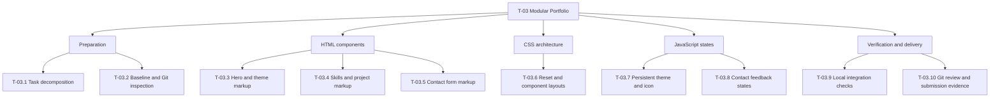

# TASK_DECOMPOSITION

## 1. Objective and scope

Exercise 3: Component Architecture & State Modeling — Modular Portfolio.

Extend the Exercise 2 portfolio in a separate Exercise3 folder, reusing
index.html, styles.css, and theme.js with vanilla HTML, CSS, and JavaScript.

Requirements are based on the exercise excerpt and student instructions
provided in this conversation. The complete assignment has not been reviewed.

### Required components

- Hero: high-resolution portrait with explicit width and height attributes,
  a headline, and a short introduction.
- Theme switcher: accessible button with synchronized aria-pressed and
  dynamic icon; preserve the localStorage key "theme".
- Skills: categorized badges arranged using CSS Grid.
- Projects: self-contained article elements with descriptions, tags,
  and real links when available.
- Contact: native form validation and client-side feedback states.
  No message delivery is implemented or promised.

### Implementation constraints

- Preserve semantic landmarks, the skip-link, matching fragment targets,
  logical heading order, and exactly one h1.
- Retain the existing zero-div approach.
- Use CSS variables for colors and an external stylesheet.
- Apply the supplied universal box-sizing, margin, and padding reset.
- Synchronize native control color-scheme with the selected theme.
- Use Flexbox with gap for suitable one-dimensional layouts.
- Use CSS Grid for categorized skills and project layouts.
- Check responsive behavior and box-model spacing.
- Do not use frameworks, CSS libraries, or CDNs.
- Keep website text, code comments, and this document in English.
- Do not fabricate projects, qualifications, contact details, or URLs.
- Label missing content clearly. Do not use fake clickable URLs.
- Keep HTML, CSS, and JavaScript changes in separate commits.
- Inspect the actual Git setup before giving repository or push commands.

## 2. Top-down WBS

## 3. Task table

Status definitions:

- Drafted: document produced; student review is pending.
- Not started: no implementation or verification recorded.
- In progress: work has begun.
- Complete: completion criteria satisfied with recorded evidence.

| ID | Task | Deliverables | Completion criteria | Dependencies | Status |
| --- | --- | --- | --- | --- | --- |
| T-03.1 | Task decomposition | TASK_DECOMPOSITION.md | Student reviews scope; WBS matches the table; AI record accurately describes actual assistance. | None | Drafted |
| T-03.2 | Baseline and Git inspection | Confirmed files, Git root, branch, remotes, status, and missing-content list | Inspect actual files for paste artifacts; inspect Git setup; identify portrait and factual content still needed. | T-03.1 | Not started |
| T-03.3 | Hero and theme markup | Hero and theme button in index.html | Portrait has explicit dimensions and appropriate alt text; confirmed headline and introduction; accessible button name and decorative icon; exactly one h1; working fragment targets. | T-03.2 | Not started |
| T-03.4 | Skills and project markup | Skill categories and project articles in index.html | Logical headings; categorized badges; cards contain descriptions and tags; genuine links when supplied; missing content clearly labeled. | T-03.3 | Not started |
| T-03.5 | Contact form markup | Labeled form controls and feedback region in index.html | Associated labels, names, suitable types, and required constraints; feedback region supports announcements; visible notice states that messages are not sent. | T-03.4 | Not started |
| T-03.6 | Reset and component layouts | Updated styles.css | Universal reset applied; colors use variables; Grid for skills and projects; Flexbox with gap where appropriate; responsive portrait; visible keyboard focus and skip-link; no horizontal overflow at tested widths. | T-03.5 | Not started |
| T-03.7 | Persistent theme and icon | Updated theme.js | Pointer and keyboard toggling work; aria-pressed and icon match the active theme; reload preserves "theme"; unavailable storage does not break toggling; native controls match the selected theme. | T-03.6 | Not started |
| T-03.8 | Contact feedback states | contact.js and deferred script reference in index.html | Native constraints block invalid submissions; idle, invalid, and locally validated states work; feedback is announced; valid submission prevents navigation and says no message was sent; editing clears stale confirmation. | T-03.5, T-03.7 | Not started |
| T-03.9 | Local integration checks | Actual check results and relevant screenshots | Student checks semantics, keyboard access, portrait, links, responsive layout, both themes, persistence, invalid and valid form inputs, and console errors; failures resolved. | T-03.6, T-03.7, T-03.8 | Not started |
| T-03.10 | Git review and submission evidence | Separate commits, real commit identifiers, real AI links, and required submission links | Review actual diffs and Git setup; separate HTML, CSS, and JavaScript commits; verify tracked files and final status; use verified branch and remote for an authorized push; confirm submission requirements. | T-03.9 | Not started |

Dependencies describe implementation order. Commit verified changes at
appropriate milestones rather than combining all file types at the end.

## 4. Planned state model

| Component | States | Expected behavior |
| --- | --- | --- |
| Theme | light, dark | Initialize from a valid saved value or default to light; update theme, aria-pressed, and icon together; save with the key "theme" when storage is available. |
| Contact | idle, invalid, locally validated | Native constraints block invalid input; provide correction feedback; valid input produces local confirmation stating that no message was sent; editing clears stale confirmation. |

These are planned behaviors, not completed implementation or test results.

No sending, server-success, or network-failure state is claimed because
no real submission mechanism has been implemented.

## 5. AI assistance record

| Stage | Actual assistance | Student action / evidence | Real conversation link |
| --- | --- | --- | --- |
| Exercise 2 baseline | Student reports completing Exercise 2 with AI assistance and supplied the three baseline files as text. Full earlier assistance history has not been reviewed here. | Local files and previous checks have not been independently verified in this conversation. | [PLACEHOLDER: actual Exercise 2 shared conversation URL] |
| Exercise 3 planning | ChatGPT drafted the objective, WBS, task table, planned state model, and assistance record from the supplied requirements and baseline. | Student review pending. No website implementation or local browser/Git checks performed by the assistant. | [PLACEHOLDER: actual shared URL for this Exercise 3 conversation] |
| Exercise 3 implementation | Not started. Update this row with the specific AI-provided code or review actually used. | [PLACEHOLDER: actual student edits and verification evidence] | [PLACEHOLDER: actual relevant conversation URL] |

Placeholders are not URLs or submission evidence. Replace them with real
links when available. Do not invent links, commit identifiers, screenshots,
or passed checks. Update this record as assistance occurs.

## 6. Verification and evidence log

No Exercise 3 local checks have been performed or reported in this conversation.

| Check | Actual result | Evidence |
| --- | --- | --- |
| Local baseline and Git inspection | Not checked | Pending |
| Semantic structure and keyboard access | Not checked | Pending |
| Portrait, content, and links | Not checked | Pending |
| Responsive layout and box model | Not checked | Pending |
| Theme state, icon, and persistence | Not checked | Pending |
| Native validation and contact feedback | Not checked | Pending |
| Console errors and final Git review | Not checked | Pending |

Record actual outcomes after checking. Mark a task Complete only when its
completion criteria are satisfied. Suggested code or a screenshot of code
alone does not establish a passed browser check.