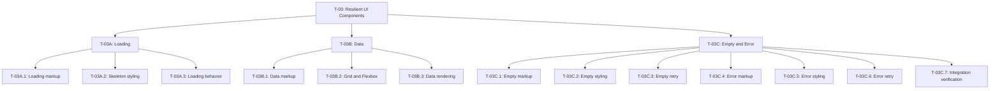
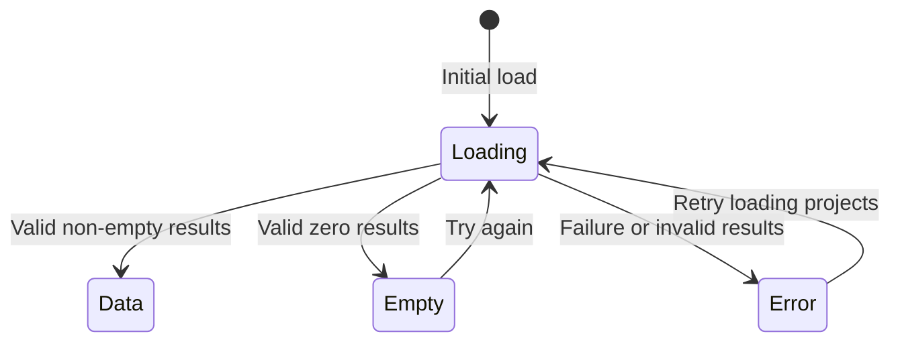

# TASK_DECOMPOSITION

## 1. Objective and requirements

Exercise 4: Resilient UI Components.

Extend the Exercise 3 portfolio with a project component that supports
Loading, Data, Empty and Error states.

The inherited Exercise 3 portfolio was developed with AI assistance.
Its current source has not been reviewed in this planning session.

Requirements:

- Use vanilla HTML, CSS and JavaScript.
- Use English for code, website text and documentation.
- T-03A: Implement a Loading state with skeleton shimmer.
- T-03B: Implement a Data state with Flexbox badges and a Grid layout.
- T-03C: Implement Empty and Error states with accessible retry controls.
- Preserve inherited semantic structure, navigation, skip links,
  portfolio sections, contact behavior and theme behavior.
- Retain the inherited no-div constraint.
- Reuse existing CSS tokens and support a 375px viewport.
- Support keyboard navigation, visible focus and reduced motion.
- Use actual coursework content and meaningful project links.
- Plan separate commits for each state.
- Keep CSS and JavaScript changes in separate commits.

This document contains planning only. No implementation code has been
generated and no browser tests have been performed.

The subtasks and commit boundaries below are proposed planning decisions.
They are not additional verified assignment requirements.

## 2. Top-down WBS

## 3. Task table

All new tasks are **Not started**.
Preparing this document does not count as implementing a task.

| ID | Deliverable | Completion criteria | Dependencies | Status |
| --- | --- | --- | --- | --- |
| T-03 | Resilient project component | All child tasks complete; four states and inherited behavior verified | Exercise 3 source; T-03A, T-03B, T-03C | Not started |
| T-03A | Loading state | Loading markup, shimmer and loading behavior verified | T-03A.1–T-03A.3 | Not started |
| T-03A.1 | Semantic loading markup and status region | Component is labelled; skeletons are decorative; loading text is available | Review inherited source and state contract | Not started |
| T-03A.2 | Skeleton CSS | Shimmer supports both themes; reduced motion disables animation; no overflow at 375px | T-03A.1 | Not started |
| T-03A.3 | Loading JavaScript | Every attempt enters Loading; busy state is set; duplicate attempts are prevented | T-03A.1, T-03A.2 | Not started |
| T-03B | Data state | Project articles use Grid and Flexbox badges | T-03A; T-03B.1–T-03B.3 | Not started |
| T-03B.1 | Semantic project markup | Articles include headings, descriptions, technology tags and meaningful links using actual coursework | T-03A | Not started |
| T-03B.2 | Grid and Flexbox CSS | Articles use Grid; badges wrap with Flexbox; both themes and 375px layout verified | T-03B.1 | Not started |
| T-03B.3 | Data rendering JavaScript | Valid non-empty results enter Data; busy state clears; text is rendered safely | T-03B.1, T-03B.2, T-03A.3 | Not started |
| T-03C | Empty and Error states | Both states provide accessible feedback and working retry transitions | T-03B; T-03C.1–T-03C.7 | Not started |
| T-03C.1 | Empty markup | Clear no-results message and native retry button | T-03B | Not started |
| T-03C.2 | Empty CSS | Message and visible button focus work in both themes and at 375px | T-03C.1 | Not started |
| T-03C.3 | Empty retry JavaScript | Zero results enter Empty; retry enters Loading; keyboard and focus behavior verified | T-03C.1, T-03C.2, T-03A.3 | Not started |
| T-03C.4 | Error markup | Clear failure message and native retry button | T-03C.3 | Not started |
| T-03C.5 | Error CSS | Error feedback and visible button focus work in both themes and at 375px | T-03C.4 | Not started |
| T-03C.6 | Error retry JavaScript | Failures enter Error; retry enters Loading; later attempts can reach any result state | T-03C.4, T-03C.5, T-03A.3 | Not started |
| T-03C.7 | Integration verification record | All transitions, accessibility, responsive layout and inherited behavior checked; actual outcomes recorded | T-03A, T-03B, T-03C.3, T-03C.6 | Not started |

Dependencies describe the proposed implementation order.

## 4. State-machine contract

The state machine controls only the project component.
Other portfolio sections remain usable.

The first load attempt begins in Loading.

### State definitions

| State | Visible content | Accessibility and behavior |
| --- | --- | --- |
| Loading | Skeletons and "Loading projects..." | Set aria-busy to true; hide decorative skeletons from assistive technology; announce loading |
| Data | Project articles and technology badges | Clear aria-busy; announce result count; expose meaningful headings and links |
| Empty | "No projects found." and a "Try again" button | Clear aria-busy; announce no results; allow keyboard and pointer retry |
| Error | "Projects could not be loaded. Please try again." and a "Retry loading projects" button | Clear aria-busy; announce failure; allow keyboard and pointer retry |

### Transition and accessibility rules

1. Exactly one state is active and visible.
   Inactive content must not remain keyboard-focusable.

2. Every load attempt enters Loading before reaching Data, Empty or Error.

3. Valid non-empty results enter Data.
   Valid zero results enter Empty.
   Rejected loads or invalid results enter Error.

4. Define and validate the project data shape before rendering.
   Use textContent for plain text rather than innerHTML.

5. Empty and Error retry the same load operation.
   Retry must not reload the page or reset the theme or contact form.

6. Allow only one active attempt.
   Prevent duplicate activation and stale results.

7. Maintain a stable polite status region outside the busy content.
   Avoid duplicate announcements.

8. Initial loading must not move focus.
   After retry, keep focus on a stable control during Loading.
   Before hiding that control, move focus to the persistent component
   heading. Never leave focus on hidden or removed content.

9. Disable skeleton animation when prefers-reduced-motion is enabled.
   Keep the loading text available.

10. Controlled local outcomes may be used to demonstrate Data, Empty
    and Error. Document simulated behavior honestly.
    Do not imply that a real backend exists.

## 5. Commit plan

Commit this planning document before implementation.

Each row below represents a separate commit.
Stage only the intended changes and inspect the staged diff.
Never combine CSS and JavaScript in one commit.

| Order | Task | Commit scope |
| --- | --- | --- |
| 0 | Planning | TASK_DECOMPOSITION.md only |
| 1 | T-03A.1 | Loading HTML only |
| 2 | T-03A.2 | Loading CSS only |
| 3 | T-03A.3 | Loading JavaScript only |
| 4 | T-03B.1 | Data HTML only |
| 5 | T-03B.2 | Data CSS only |
| 6 | T-03B.3 | Data JavaScript only |
| 7 | T-03C.1 | Empty HTML only |
| 8 | T-03C.2 | Empty CSS only |
| 9 | T-03C.3 | Empty JavaScript only |
| 10 | T-03C.4 | Error HTML only |
| 11 | T-03C.5 | Error CSS only |
| 12 | T-03C.6 | Error JavaScript only |
| 13 | T-03C.7 | Verification documentation and actual status updates only |

If a new JavaScript file is needed, add its deferred script link in an
HTML-only commit and its behavior in a JavaScript-only commit.

Choose accurate English commit messages describing the actual changes.
No assignment-mandated commit messages have been provided or invented.

Record actual commit hashes after the commits exist.

## 6. Planned verification

- Observe initial Loading and its skeleton shimmer.
- Trigger Data, Empty and Error outcomes.
- Verify Empty → Loading and Error → Loading retry transitions.
- Verify duplicate activation prevention and focus behavior.
- Check keyboard navigation, visible focus and status announcements.
- Check reduced-motion behavior.
- Check Grid articles and wrapping Flexbox badges.
- Check desktop and 375px layouts in both themes.
- Check inherited semantic landmarks, one h1 and heading order.
- Check navigation and skip-link targets.
- Check inherited theme switching and persistence.
- Check inherited contact demonstration behavior.
- Record actual results, failures, fixes and relevant screenshots.

Verification status: **Not started**.

No tests have been run or claimed to pass in this planning session.
Mark tasks complete only after their completion criteria are met.

## 7. AI assistance record

### Inherited Exercise 3 work

The Exercise 3 portfolio was developed with AI assistance,
as disclosed by the student.

The earlier assistance and current source were not audited
in this planning session.

### Current Exercise 4 assistance

ChatGPT assisted with drafting:

- Objective and requirements.
- WBS and matching task table.
- Deliverables, completion criteria and dependencies.
- State-machine and accessibility contract.
- Commit boundaries and planned verification.

No HTML, CSS or JavaScript implementation has been generated
in this session.

### Student responsibility

The student will review this plan against the actual assignment
and current source, understand the implementation, perform verification
and update task statuses honestly.

Actual Exercise 4 chat link:
[ADD THE ACTUAL CHAT LINK BEFORE SUBMISSION]

Earlier Exercise 3 AI chat link, if required:
[ADD THE ACTUAL EXERCISE 3 CHAT LINK]

Actual implementation commit references:
[ADD AFTER COMMITS EXIST]

This record does not claim independent authorship,
verified lecturer approval or successful tests.