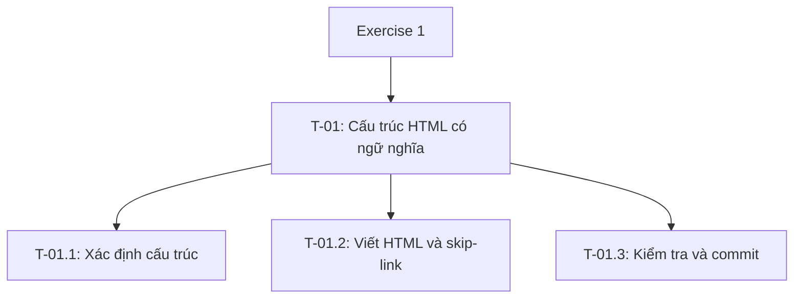

# TASK_DECOMPOSITION

## 1. Mục tiêu và yêu cầu

Exercise 1: Semantic DOM Architecture & A11y Contract.

Yêu cầu:
- Không sử dụng thẻ div.
- Có đúng một h1; không nhảy cấp tiêu đề.
- Có skip-link dẫn đến nội dung chính.
- Có cấu trúc landmark rõ ràng.
- Kiểm tra bằng Chrome DevTools > Accessibility.
- Commit HTML riêng, không gộp CSS hoặc JavaScript.

## 2. WBS

## 3. Bảng nhiệm vụ

| Mã WBS | Công việc | Sản phẩm đầu ra | Tiêu chí hoàn thành | Phụ thuộc | Trạng thái |
|---|---|---|---|---|---|
| T-01 | Cấu trúc HTML có ngữ nghĩa | HTML đã kiểm tra và commit | Các nhiệm vụ con hoàn thành | Không | Chưa xong |
| T-01.1 | Xác định cấu trúc | Hợp đồng cấu trúc bên dưới | Xác định vùng, tiêu đề và đích skip-link | Không | Chờ kiểm tra |
| T-01.2 | Viết HTML và skip-link | index.html | Không div; một h1; liên kết đúng đích | T-01.1 | Chưa xong |
| T-01.3 | Kiểm tra và commit | Kết quả kiểm tra và commit HTML | Kiểm tra Accessibility; commit riêng HTML | T-01.2 | Chưa xong |

## 4. Hợp đồng cấu trúc — T-01.1

- Skip-link đặt trước header, dẫn đến #main-content.
- header chứa tên và một h1.
- nav chứa liên kết đến #about và #projects.
- main có id="main-content".
- main chứa section #about và section #projects.
- Mỗi section có h2.
- Không sử dụng div.
- Nhiệm vụ này chưa thêm CSS hoặc JavaScript.

## 5. Ghi nhận sử dụng AI

- Nhiệm vụ được hỗ trợ: T-01.1.
- Mục đích: phân tích yêu cầu và đề xuất WBS.
- Công cụ: ChatGPT.
- Link prompt/cuộc trò chuyện: Chưa bổ sung.
- Phần tôi tự thực hiện: Chưa ghi nhận.
- Cách kiểm tra: đối chiếu slide 5, 7, 8 và kiểm tra WBS.
- Kết quả kiểm tra: Chưa thực hiện.